# AI QA Platform

> **© 2026 Mostafa Ashry. All rights reserved.**
> This repository is public **for viewing and portfolio presentation only**. It is
> **not** open source. You may not copy, reuse, modify, redistribute, or use any
> part of it — including the skills and prompts — in your own projects, and no
> commercial use is permitted. See [LICENSE](LICENSE).

A reusable, AI-driven QA workflow built on **Claude Code skills**. It takes a
software project from raw requirements to reviewed test cases, evidence-backed
manual execution, generated UI automation, controlled self-healing and an
evidence-based final QA report — with a human approval gate between stages and an
auditable journal of every AI action.

The platform is **application-agnostic**: nothing in the skills, prompts, workflow
or templates is tied to a specific product. Project details live only in individual
task folders, which are not part of this repository.

---

## Highlights

- **Gated, staged workflow** — each stage writes one artifact, then hard-stops until
  a human replies with an exact approval key (for example `PRD_APPROVED`).
- **Mandatory test review** ([ADR-001](docs/architecture/decisions/ADR-001-mandatory-test-review.md)) —
  no manual execution or automation without a review bound by SHA-256 to the exact
  reviewed `TestCases.md`.
- **Evidence over assertion** — every claim about application behavior must point to
  a screenshot, response, log or trace. Unknown expected results are marked
  `Not established`, never invented.
- **Flag-driven scope** — `Valid in Scope` controls manual execution; `Needs
  Automation` controls automation generation.
- **Multi-framework automation** — scaffolds for SHAFT + Selenium + Java/TestNG
  (platform default), Playwright + TypeScript, and Playwright for Java/TestNG.
- **Honest self-healing** — may fix locators, waits, setup and configuration; never
  changes an assertion or heals an application defect. Max three attempts per failure.
- **Auditable journal** — JSON-Schema-validated events and verbatim, hashed prompt
  records per task.
- **Secrets discipline** — credentials come from environment variables only and are
  redacted as `[REDACTED: <kind>]` everywhere.

## Workflow at a glance

```mermaid
flowchart LR
    T([Task creation]) --> PRD[PRD Generation]
    PRD -->|PRD_APPROVED| PC[Project Context]
    PC -->|PROJECT_CONTEXT_APPROVED| EX[Exploration]
    EX -->|EXPLORATION_APPROVED| TD[Test Design]
    TD -->|TEST_DESIGN_APPROVED| TR[Test Review<br/>mandatory]
    TR -->|TEST_REVIEW_APPROVED| ME[Manual Execution]
    ME -->|MANUAL_EXECUTION_APPROVED| AG[Automation Generation]
    AG --> AE[Automation Execution]
    AE -->|non-passing, not an app defect| SH[Self-Healing]
    SH -->|verification rerun| AE
    AE --> QFR[QA Final Report]
    QFR -->|QA_FINAL_REPORT_APPROVED| END([QA workflow closed])
    ST[Security Testing<br/>not integrated]:::partial -.-> QFR
    classDef partial stroke-dasharray: 5 5
```



## Implementation status

| Stage / capability | Skill | Version | Status |
|---|---|---|---|
| PRD Generation | `prd-generation` | 1.0.1 | Implemented |
| Project Context | `project-context` | 1.1.1 | Implemented |
| Exploration | `exploration` | 1.0.0 | Implemented (Playwright MCP) |
| Test Design | `test-design` | 1.0.1 | Implemented |
| Test Review | `test-review` | 1.0.0 | Implemented, mandatory |
| Manual Execution | `manual-execution` | 1.1.0 | Implemented (Playwright MCP) |
| Automation Generation | `automation-generation` | 1.1.0 | Implemented (3 scaffolds). **Unresolved dependency:** requires `test-design/TestCases.csv`, which no existing skill generates |
| Automation Execution | `automation-execution` | 1.0.0 | Implemented |
| Self-Healing | `self-healing` | 1.0.0 | Implemented (conditional loop) |
| QA Final Report | `qa-final-report` | 1.0.0 | Implemented (Markdown + HTML; Node.js renderer produces a draft preview) |
| Security Testing | `security-testing` | 1.0.0 | **Partial** — skill definition, scope template and test catalog exist; prompt, 6 of 7 output templates and journal template are missing; not wired into the workflow or registry |
| Reporting | `reporting` | — | **Planned** — registry entry only |
| Workflow orchestration (runner) | — | — | **Not implemented** — a human operator performs task creation and stage hand-offs |

Full details: [Limitations and Roadmap](docs/limitations-and-roadmap.md).

## Repository layout

```
.claude/
  skills/             one folder per skill: SKILL.md, output templates, journal templates
  settings.json       enables the Playwright MCP server; denies edits to platform/templates/
.playwright-mcp/      Playwright MCP runtime output (git-ignored except README)
.github/              issue templates and a repository-checks workflow
docs/                 architecture, ADRs, guides and reference documentation
platform/
  workflows/          default-qa-workflow.yaml — stage order, inputs, outputs, gates
  registry/           skills.yaml — skill catalog and status
  schemas/            JSON Schemas for journal events, prompt records, runs, metrics
  templates/          immutable task template (copied per task)
  knowledge-base/     reserved for reusable QA knowledge (empty)
  tasks/              task instances (git-ignored; none are published)
reports/              cross-task reports (git-ignored)
.mcp.json             Playwright MCP server configuration
.env.example          reference list of automation environment variables
CLAUDE.md             platform principles and rules loaded by Claude Code
```

## Documentation

| Topic | Document |
|---|---|
| Documentation index | [docs/README.md](docs/README.md) |
| System architecture | [docs/architecture/system-architecture.md](docs/architecture/system-architecture.md) |
| Complete QA workflow | [docs/guides/qa-workflow.md](docs/guides/qa-workflow.md) |
| Skills reference | [docs/reference/skills.md](docs/reference/skills.md) |
| Prompts reference (prompt files not published) | [docs/reference/prompts.md](docs/reference/prompts.md) |
| Installation | [docs/guides/installation.md](docs/guides/installation.md) |
| Configuration | [docs/guides/configuration.md](docs/guides/configuration.md) |
| Security and privacy | [docs/security-and-privacy.md](docs/security-and-privacy.md) |
| Troubleshooting | [docs/guides/troubleshooting.md](docs/guides/troubleshooting.md) |
| Limitations and roadmap | [docs/limitations-and-roadmap.md](docs/limitations-and-roadmap.md) |
| Execution journal architecture | [docs/architecture/ai-qa-execution-journal.md](docs/architecture/ai-qa-execution-journal.md) |

## What this repository does not contain

- No task instances, test cases, execution results, bug reports, screenshots or
  security findings from any real project.
- No credentials, tokens, private URLs or customer data.
- No stage prompt files: the versioned prompts (`.claude/prompts/`) are withheld; see
  the [Prompts Reference](docs/reference/prompts.md).
- No demo application.

## License

**All Rights Reserved.** Viewing on GitHub is the only permitted use. See
[LICENSE](LICENSE) for the full terms, and [SECURITY.md](SECURITY.md) for reporting
a security concern.
