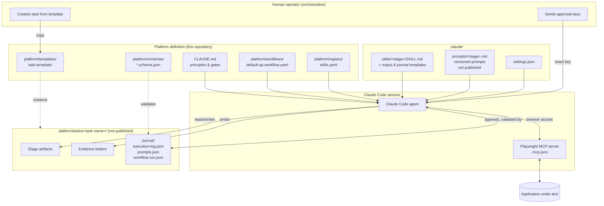

# System Architecture

> © 2026 Mostafa Ashry. All rights reserved. View-only; see [LICENSE](../../LICENSE).

## 1. Overview

The AI QA Platform is a set of **Claude Code skills** orchestrated by a declarative
**workflow definition**. Each skill implements one QA stage, reads approved
artifacts from a **task folder**, writes its own artifact into the same folder,
appends events to the task's **journal**, and — for gated stages — stops until a
human sends an exact approval key.

There is no server or runtime service. The "runtime" is Claude Code operating on
the file system, with the Playwright MCP server providing browser access to the
application under test for the stages that observe it.

## 2. Components



| Component | Location | Responsibility |
|---|---|---|
| Platform principles | [`CLAUDE.md`](../../CLAUDE.md) | Rules Claude Code loads for every session: reusability, task isolation, evidence, gates, ownership, secrets, tooling |
| Workflow definition | [`platform/workflows/default-qa-workflow.yaml`](../../platform/workflows/default-qa-workflow.yaml) | Stage order, dependencies, inputs/outputs, gates, approval policy (v0.12.0) |
| Skill registry | [`platform/registry/skills.yaml`](../../platform/registry/skills.yaml) | Catalog of skills with status, version, paths, inputs/outputs, MCP rules (v0.12.0) |
| Skills | [`.claude/skills/`](../../.claude/skills/) | *How* a stage works: prerequisites, rules, validation, failure codes, journal integration |
| Prompts | `.claude/prompts/` (**not published in this repository**; see [Prompts Reference](../reference/prompts.md)) | The versioned instruction text a stage runs with; recorded verbatim and hashed per task |
| Schemas | [`platform/schemas/`](../../platform/schemas/) | JSON Schemas for journal events, prompt records, workflow runs and automation metrics |
| Task template | [`platform/templates/task-template/`](../../platform/templates/task-template/) | Immutable folder skeleton copied once per task |
| Claude Code settings | [`.claude/settings.json`](../../.claude/settings.json) | Enables the Playwright MCP server; denies `Edit`/`Write` on `platform/templates/**` |
| MCP config | [`.mcp.json`](../../.mcp.json) | Starts `@playwright/mcp` with output to `.playwright-mcp/` |

## 3. Separation of concerns

Every skill document repeats the same split:

| Concept | Owns |
|---|---|
| **Skill** (`SKILL.md`) | *How* the stage works: rules, checks, failure conditions |
| **Prompt** (`.claude/prompts/*.md`) | The versioned instruction, identified by `prompt_id` + `prompt_version` |
| **Workflow** (YAML) | *When* a stage runs and what it depends on |
| **Journal** | *What happened*: sources, decisions, actions, evidence, validation, gate replies |
| **Artifacts** | The stage's outputs in the task folder |

## 4. Task folder model

```
platform/tasks/<task-name>/
├── context/            TaskContext.md (identity + verbatim intake), ProjectContext.md
├── prd/                PRD.md
├── exploration/        ExplorationReport.md, evidence/
├── test-design/        TestCases.md (TestCases.csv is read by automation-generation; see Limitations)
├── test-review/        TestReview.md
├── execution/          ExecutionReport.md, evidence/
├── bugs/               BugReports.md (only when defects exist)
├── automation/         AutomationGeneration.md, <project-dir>/ per binding
├── automation-execution/  results/<run-id>/<project-dir>/, execution-metrics.json, reports
├── self-healing/       healing-log.md
├── reports/            QA-Final-Report.md, QA-Final-Report.html
└── journal/            execution-log.json, prompts.json, workflow-run.json
```

Tasks are isolated: a stage never reads or writes another task's folder unless
explicitly told to. Task folders are git-ignored in this repository.

### Artifact ownership

| Artifact | Written by | Never written by |
|---|---|---|
| `context/TaskContext.md` | Orchestration at task creation | Any skill |
| `journal/workflow-run.json` (`workflow_run_id`) | Orchestration | Any skill (read-only) |
| `prd/PRD.md` | `prd-generation` | — |
| `context/ProjectContext.md` | `project-context` | — |
| `exploration/ExplorationReport.md` | `exploration` | — |
| `test-design/TestCases.md` | `test-design` | `test-review` (never edits cases) |
| `test-review/TestReview.md` | `test-review` | — |
| `execution/ExecutionReport.md`, `bugs/BugReports.md` | `manual-execution` | — |
| `automation/**` | `automation-generation`; minimal fixes by `self-healing` | `automation-execution` |
| `automation-execution/**` | `automation-execution` | — |
| `self-healing/healing-log.md` | `self-healing` (append-only) | — |
| `reports/QA-Final-Report.*` | `qa-final-report` | — |

## 5. Approval and binding model

- Gated stages **hard-stop** after producing their artifact.
- Only the exact, standalone, case-sensitive key unlocks the next stage; anything
  else (including "approved" or the key mixed with text) is rejected and journaled
  as `approval_decision / not_accepted`.
- Approvals are **bound to content hashes**. Editing an approved artifact makes its
  approval stale, and downstream stages refuse to start.
- `TEST_REVIEW_APPROVED` is bound to the SHA-256 of the exact reviewed
  `TestCases.md` plus the approved `ProjectContext.md` and `ExplorationReport.md`
  hashes, and is refused while a `Change Required` finding is open.
- Revisions update the same artifact in place with a semantic version bump; no
  `-v2` or `-final` copies.

## 6. Journal

Each task has an append-only journal:

| File | Content | Schema |
|---|---|---|
| `journal/execution-log.json` | One event per significant action (`stage_execution`, `revision_request`, `approval_decision`) with inputs, outputs, hashes, validation and stage-specific blocks | [`journal-event.schema.json`](../../platform/schemas/journal-event.schema.json) |
| `journal/prompts.json` | One record per `(prompt_id, prompt_version)`, stored verbatim with SHA-256 | [`prompt-record.schema.json`](../../platform/schemas/prompt-record.schema.json) |
| `journal/workflow-run.json` | Active run ID and run list, owned by orchestration | [`workflow-run.schema.json`](../../platform/schemas/workflow-run.schema.json) |
| `automation-execution/execution-metrics.json` | Per-run, per-case automation metrics | [`execution-metrics.schema.json`](../../platform/schemas/execution-metrics.schema.json) |

See [ai-qa-execution-journal.md](ai-qa-execution-journal.md) for the full design.

## 7. Tooling boundaries

| Tool | Role | Used by |
|---|---|---|
| Playwright MCP | Browser **access** for observing the live app — not an automation framework | `exploration`, `manual-execution` (required); `automation-generation`, `self-healing` (optional, read-only); `security-testing` EXECUTE (pending integration) |
| SHAFT + Selenium + Java/TestNG | Platform-default automation binding | Generated by `automation-generation`, run by `automation-execution` |
| Playwright Test (TypeScript) | Alternative binding | same |
| Playwright for Java + TestNG | Alternative binding | same |
| Node.js renderer | Draft HTML preview of the QA Final Report | `qa-final-report` |

Note: `CLAUDE.md`'s Tooling Rule names only `exploration` and `manual-execution` as
Playwright MCP users; the registry additionally allows optional read-only use by
`automation-generation` and `self-healing`.

## 8. Design principles

1. **Reusability** — no application-specific content in platform files.
2. **Task isolation** — one folder per task.
3. **Evidence-based testing** — every behavioral claim references evidence.
4. **No fabrication** — unknowns become assumptions or open questions.
5. **Explore before designing.**
6. **Mandatory review** before execution and automation (ADR-001).
7. **Flag-controlled scope** — `Valid in Scope`, `Needs Automation`.
8. **Honest self-healing** — never changes assertions.
9. **Journal everything important.**
10. **Immutable templates**, **modular skills**, **replaceable stages**.
