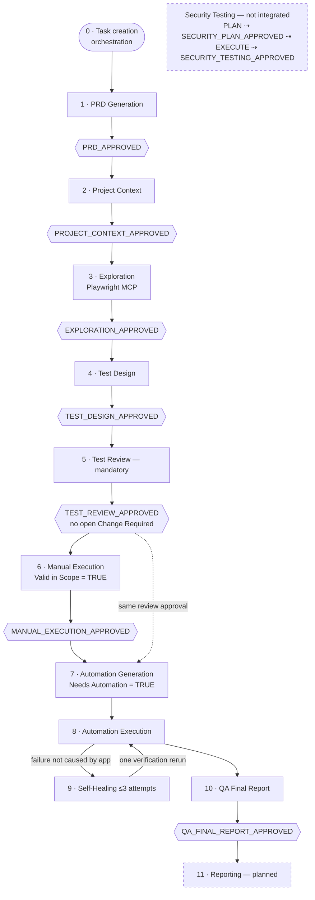

# Complete QA Workflow

> © 2026 Mostafa Ashry. All rights reserved. View-only; see [LICENSE](../../LICENSE).

Source of truth: [`platform/workflows/default-qa-workflow.yaml`](../../platform/workflows/default-qa-workflow.yaml)
(v0.12.0). This guide describes what that file and the skills define.

## 1. End-to-end flow

## 2. Approval policy

| Rule | Value |
|---|---|
| Match | Exact, standalone, case-sensitive key; surrounding whitespace ignored |
| Key mixed with other text | Rejected |
| General approval ("approved", "looks good", "continue") | Rejected |
| Bypass | Never: a stage does not start without every required approval, even if its inputs exist |
| Revisions | Update the same artifact in place, with a version bump |
| Staleness | An approval is void when the approved artifact's hash changes or a later execution of that stage exists |

## 3. Stages

### 0 · Task creation (orchestration, not a skill)

1. Copy `platform/templates/task-template/` to `platform/tasks/<task-name>/`.
2. Fill `context/TaskContext.md`: identity, entry points (UI/API URL, environment)
   and the **verbatim** intake. No analysis.
3. Create a run in `journal/workflow-run.json` and set `active_run_id` (e.g. `RUN-001`).

### 1 · PRD Generation — `prd-generation`

- **Input:** TaskContext intake, supporting documents, user-supplied information,
  project URLs (at most one non-browser reachability check).
- **Output:** `prd/PRD.md`, a 20-section traceable PRD. Documented intent only.
- **MCP:** forbidden.
- **Gate:** `PRD_APPROVED` → unlocks Project Context.

### 2 · Project Context — `project-context`

- **Input:** approved PRD (+ knowledge-base material it references).
- **Output:** `context/ProjectContext.md`: scope decomposition, boundaries, roles,
  business rules (`PC BR-###`), expected behaviors (`PC EB-###`), dependencies,
  assumptions, risks, gaps, open questions, traceability, QA scope preparation.
- **MCP:** forbidden.
- **Gate:** `PROJECT_CONTEXT_APPROVED` → unlocks Exploration.

### 3 · Exploration — `exploration`

- **Input:** approved ProjectContext (expectation baseline), live application.
- **Output:** `exploration/ExplorationReport.md` + `exploration/evidence/`. Every
  observation is exactly one of **MATCH / FINDING / GAP / QUESTION / POTENTIAL BUG**;
  every non-MATCH has evidence; candidate locators (`LOC-###`) are recorded.
- **MCP:** Playwright (required, browser access only).
- **Gate:** `EXPLORATION_APPROVED` → unlocks Test Design.

### 4 · Test Design — `test-design`

- **Input:** approved ProjectContext and ExplorationReport.
- **Techniques:** Equivalence Partitioning, Boundary Value Analysis, Decision Table,
  State Transition, Pairwise, and (supplementary) Error Guessing.
- **Output:** `test-design/TestCases.md`: cases with one expected result each,
  traceability matrix, technique rationale, exploratory cases, open questions,
  coverage gaps, test-data requirements, coverage summary, and per-case flags
  **`Valid in Scope`** and **`Needs Automation`**. Unsupported expected results are
  `Not established` (→ Exploratory / Open Question).
- **MCP:** forbidden.
- **Gate:** `TEST_DESIGN_APPROVED` → unlocks Test Review.

### 5 · Test Review — `test-review` (mandatory, ADR-001)

- **Input:** the approved `TestCases.md` (bound by SHA-256), approved ProjectContext
  and ExplorationReport.
- **Checks:** missing coverage, duplicates, unclear steps, invalid expected results,
  missing preconditions, unsupported assumptions, traceability errors, flag
  inconsistencies.
- **Findings:** `Change Required` (blocks approval while open) or `Advisory`. Each has
  a proposed change and reason. The review **never edits** test cases; changes go
  back through a Test Design revision and a new review.
- **Gate:** `TEST_REVIEW_APPROVED` → unlocks Manual Execution and Automation Generation.

### 6 · Manual Execution — `manual-execution`

- **Filter:** `Valid in Scope = TRUE`, Active, expected result established.
- **Procedure:** follow each step exactly; record verbatim expected vs observed
  actual; assign **PASS / FAIL / BLOCKED**.
- **Failure causes:** `APPLICATION_DEFECT`, `TEST_CASE_DEFECT`, `TEST_DATA_PROBLEM`,
  `ENVIRONMENT_PROBLEM`, `DEPENDENCY_PROBLEM`, `UNKNOWN`.
- **Output:** `execution/ExecutionReport.md`, `execution/evidence/`, and
  `bugs/BugReports.md` only when application defects exist — one report per distinct
  defect, severity and priority assessed independently.
- **MCP:** Playwright (required).
- **Gate:** `MANUAL_EXECUTION_APPROVED` → unlocks Automation Generation.

### 7 · Automation Generation — `automation-generation`

- **Requires:** `TEST_REVIEW_APPROVED` (the same approval used by the approved manual
  execution) and `MANUAL_EXECUTION_APPROVED`.
- **Required input with no producer:** `test-design/TestCases.csv`, used to cross-check
  the `Needs Automation` / `Valid in Scope` flags. **No existing skill generates this
  file** (`test-design` writes only `TestCases.md`), so it currently has to be supplied
  manually. See [Limitations G-1](../limitations-and-roadmap.md#3-known-gaps-and-inconsistencies).
- **Filter:** `Needs Automation = TRUE`, plus Active, Valid in Scope, established
  expected result, and latest approved manual result PASS (or FAIL by application defect).
- **Output:** `automation/AutomationGeneration.md` and one project per binding
  (`shaft-java-testng` default, `playwright-ts`, `playwright-java-testng`). One test per
  case, approved steps labeled verbatim, expected results asserted exactly,
  credentials from environment variables only.
- **Validation:** static only — compile, test discovery, forbidden-pattern and secret
  scans. The suite is **not** run in this stage.
- **Gate:** none (hand-off to Automation Execution).

### 8 · Automation Execution — `automation-execution`

- Runs each binding independently with its own toolchain, `retries 0`, credentials
  from environment variables, and `QA_RUN_ID` set per run.
- **Outcomes:** `passed`, `failed`, `not_run`, `harness_failed`.
- **Failure classes:** `application`, `test_script`, `configuration`, `environment`,
  `framework_defect`, `test_data`, `unknown`.
- **Output:** `automation-execution/results/<run-id>/<project-dir>/`,
  `execution-metrics.json`, one `automation-report.html` per binding.
- Never edits test code; never heals.

### 9 · Self-Healing — `self-healing` (conditional loop)

- **Trigger:** non-passing runs not caused by an application defect.
- **Allowed:** locators (to traced alternatives), waits for named states, setup,
  evidence capture, build/runner configuration, toolchain selection.
- **Forbidden:** changing assertions, expected values, steps or test data definitions;
  fixed sleeps, retries, forced clicks; healing application defects; storing credentials.
- **Loop:** one verification rerun per attempt via Automation Execution; `fixed` only
  when that run passes; at most **3 attempts per failure**, then `escalated`.
- **Output:** append-only `self-healing/healing-log.md`; minimal, hashed code changes.

### 10 · QA Final Report — `qa-final-report`

- **Requires:** current `TEST_DESIGN_APPROVED` and `TEST_REVIEW_APPROVED`; reads all
  other stages when present and reports missing ones as "Not performed".
- **Output:** `reports/QA-Final-Report.md` and `.html` built from one data object:
  coverage, manual results, per-binding automation results, defects, failure classes,
  self-healing results, risks (`QRSK-###`), inconsistencies (`QINC-###`),
  traceability, and one recommendation.
- **Recommendation (first matching rule wins):**

  | # | Value | When |
  |---|---|---|
  | 1 | INSUFFICIENT EVIDENCE | Execution missing/unapproved without covering automation, coverage unknown, required artifact missing, or a relevant unreconciled inconsistency |
  | 2 | NO-GO | Open Critical defect, open High defect on a critical/high-priority area, or evidence of important functionality failing |
  | 3 | CONDITIONAL GO | Any open defect, blocked/unexecuted in-scope case, unresolved automation failure, open healing item, or other limitation — with explicit conditions |
  | 4 | GO | None of the above |

  The recommendation is QA advice within the tested scope, not a release approval.
- **Gate:** `QA_FINAL_REPORT_APPROVED` (refused when the report is stale).

### Security Testing — `security-testing` (partial, not integrated)

Defined as a two-phase skill for Web applications and REST APIs:

1. **PLAN** — assets, entry points, roles, trust boundaries → threats → risk →
   OWASP mapping → scenarios and cases → rules of engagement. Hard-stop at
   `SECURITY_PLAN_APPROVED`.
2. **EXECUTE** — only approved, authorized, non-destructive checks against the
   approved target; findings classified (Confirmed / Potential Vulnerability,
   Security Misconfiguration, Security Observation, False Positive, Not
   Reproducible) with likelihood × impact severity. Hard-stop at
   `SECURITY_TESTING_APPROVED`.

It is **not** part of the workflow or registry yet, and its prompt and most output
templates do not exist. See [Limitations & Roadmap](../limitations-and-roadmap.md).

### 11 · Reporting — planned

Registry placeholder only (milestone summary, workflow diagram, HTML journal).
